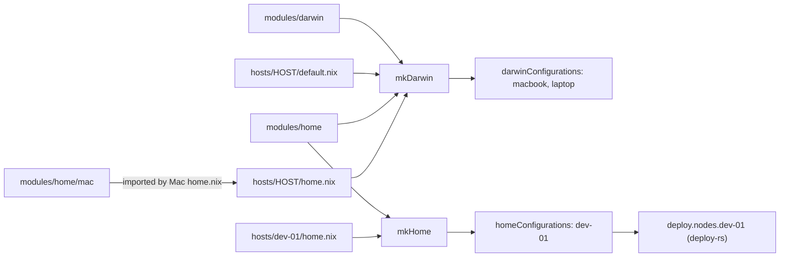
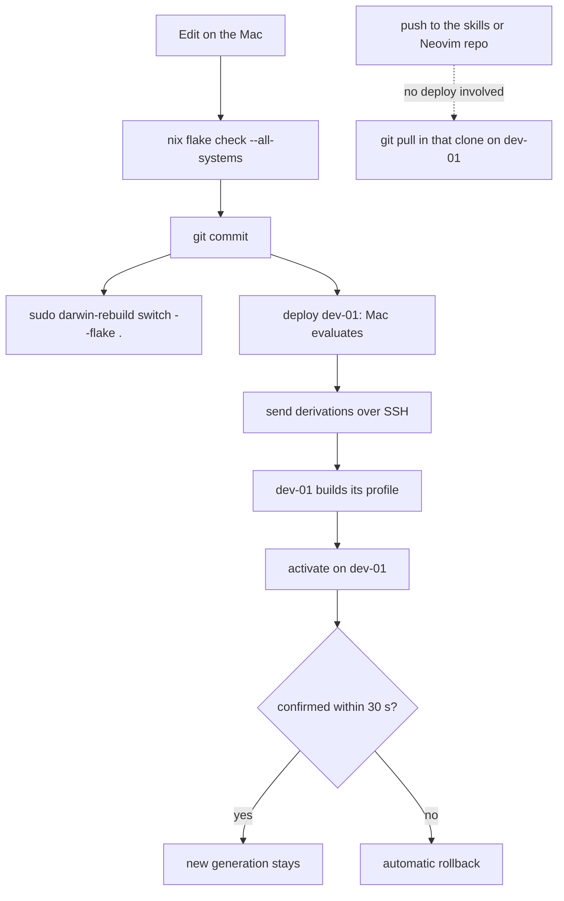
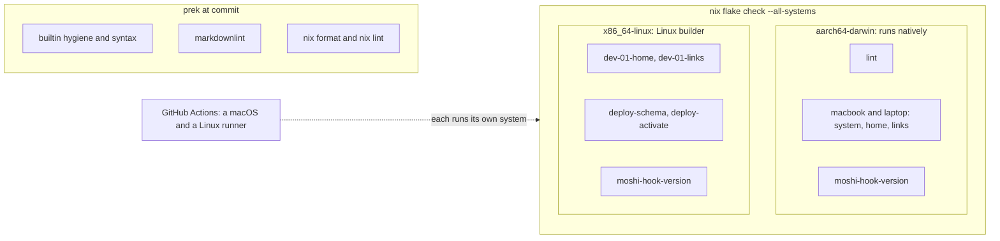

# Nix configuration

A personal flake. [nix-darwin](https://github.com/nix-darwin/nix-darwin) (the
Nix module system for macOS) owns each Mac's settings and applications, and
[Home Manager](https://nix-community.github.io/home-manager/) owns the user
environment: embedded in the Mac configuration, and standalone on the Linux VM.
The reasons behind the choices are in [DESIGN.md](DESIGN.md).

| Host | What it is | Flake output | Switched with |
| --- | --- | --- | --- |
| `macbook` | Current Mac (M2 MacBook Air) | `darwinConfigurations.macbook` | `sudo darwin-rebuild switch --flake .` on the Mac itself |
| `laptop` | New MacBook Pro (M5), user `michael`; it replaces `macbook` | `darwinConfigurations.laptop` | the same, on the laptop |
| `dev-01` | Ubuntu VM, reached over SSH from the Mac | `homeConfigurations."dev@dev-01"` | `deploy .#dev-01` from the Mac |

The two Macs never deploy to each other. dev-01 is Home Manager only: the
machines repo's bootstrap owns everything outside its home directory.

## Structure

```text
flake.nix                inputs, mkDarwin, mkHome, deploy node, checks
hosts/<host>/
├── default.nix          nix-darwin: host name, platform, user name, stateVersion (Macs)
└── home.nix             Home Manager: host-only modules, identity, stateVersion
modules/darwin/          nix-darwin modules shared by the Macs
modules/home/            Home Manager modules shared by every host
└── mac/                 Home Manager modules only the Macs import
pkgs/moshi-hook/         a package nixpkgs lacks, added by an overlay
config/                  raw application files, linked or read by the modules
prek.toml                commit hooks
.github/workflows/       CI on macOS and Linux
```

Concern files define existing nix-darwin or Home Manager options. Add a setting
to the shared module for its concern, or to `hosts/<host>/` when only one
machine needs it.

| Module | What it does |
| --- | --- |
| `darwin/system.nix` | DNS, firewall, Touch ID for sudo, tailnet-only sshd, Dock, Finder, keyboard, power settings |
| `darwin/applications.nix` | system packages, fonts, Homebrew casks, formulae and App Store apps |
| `darwin/nix.nix` | Determinate Nix owning the Nix installation, and a weekly launchd job that expires system generations older than 7 days |
| `darwin/user.nix` | the primary user's account and shell (the name itself is set in `hosts/<host>/default.nix`), Home Manager's integration settings |
| `darwin/window-management.nix` | yabai, and skhd loading the live `skhdrc` |
| `home/live-files.nix` | `nixConfig.checkout`, `nixConfig.skills` and `lib.nixConfig.file`, see [Live configuration](#live-configuration) |
| `home/shell.nix`, `cli.nix`, `yazi.nix` | fish, command-line tools, yazi |
| `home/git.nix` | Git settings, `hunk` diff viewer, `gh`, `lazygit` |
| `home/neovim.nix` | Neovim and the runtime tools Mason needs |
| `home/herdr.nix` | Herdr (terminal multiplexer) and its live config |
| `home/agents.nix` | skills links, `AGENTS.md`, Claude Code and Pi settings |
| `home/moshi.nix` | the Moshi user service, see [Services](#services) |
| `home/mac/ssh.nix`, `git.nix` | SSH hosts and keys, Git identities and macOS ignores |
| `home/mac/terminals.nix`, `karabiner.nix` | Ghostty and Karabiner, as live links |
| `home/mac/packages.nix` | Mac-only tools (`doctl`, document rendering for Neovim) |

`mkDarwin` and `mkHome` in `flake.nix` assemble each host from these directories.
A host's `home.nix` adds host-only modules on top of the shared home; each Mac's
imports `modules/home/mac`, dev-01's does not.



## Set up a new Mac

Needed once on a new machine, in this order:

1. Install Nix with the [Determinate installer](https://docs.determinate.systems/).
   Determinate Nix is a Nix distribution that manages its own daemon,
   configuration and garbage collection; this flake's `determinateNix.enable`
   makes nix-darwin leave Nix to it.

   Then give its daemon Full Disk Access, which Nix cannot declare: in System
   Settings, Privacy & Security, Full Disk Access, add
   `/usr/local/bin/determinate-nixd`, and restart it with
   `sudo launchctl kickstart -k system/systems.determinate.nix-daemon`. Without
   it, macOS stops the daemon deleting any app bundle in the store that has
   been run, and `nix store gc` aborts with `fchmodat … Operation not
   permitted`.
2. Install [Homebrew](https://brew.sh/). nix-darwin installs the casks and
   formulae listed in `modules/darwin/applications.nix`, but not Homebrew
   itself.
3. Clone this repository:
   `git clone git@github.com:mich-murphy/nix-config.git ~/dev/nix-config`. The
   Macs link live files into `~/dev/nix-config`; keep it there.
4. Clone the two repositories Home Manager links to, both over SSH:

   ```sh
   git clone git@github.com:mich-murphy/skills.git ~/dev/skills
   git clone git@github.com:mich-murphy/neovim.git ~/.config/nvim
   ```

5. Put these SSH key files in `~/.ssh/` (names only; they are read, never
   generated, by this flake):

   | File | Used for |
   | --- | --- |
   | `id_ed25519` | github.com (personal account) |
   | `github_bc` | Git inside `~/businesscraft/` (work account) |
   | `dev-01` | the `dev-01` host |

   The SSH config also reads the 1Password SSH agent, so sign in to 1Password
   and enable its agent. Steps 3 and 4 need `id_ed25519` first.
6. Check, then do the first switch. `darwin-rebuild` does not exist yet, so run
   it through `nix run`, and name the host: the machine's hostname does not match
   a flake name until this first activation has set it.

   ```sh
   cd ~/dev/nix-config
   nix flake check --no-write-lock-file
   sudo nix run nix-darwin/master#darwin-rebuild -- switch --flake .#laptop
   ```

   From then on `sudo darwin-rebuild switch --flake .` is enough. Log out and
   back in once, so that macOS loads the keyboard shortcuts and key repeat the
   switch wrote.

   If a switch stops with "Existing file ... would be clobbered", something
   has written a file where Home Manager puts a link. Move that file aside and
   switch again.
7. Open a new shell, then install the commit hooks: `prek install`.
8. Install Herdr's plugins. Nix does not install them, and
   `config/herdr/config.toml` binds keys to both:

   ```sh
   herdr plugin install -y lmilojevicc/herdr-splits.nvim --ref v0.5.4
   herdr plugin install -y plannotator/herdr-annotate --ref a9973b43c1fc90044a9f15755e310e12b8465abb
   herdr plugin list
   ```

## Set up dev-01

dev-01 has no checkout of this repo. You deploy to it from a set-up Mac (above).
The deploy path is proven; items marked "assumed" could not be checked from the
Mac.

On dev-01:

1. Install Nix (assumed: Determinate, the same as on the Mac) and enable flakes.
2. Have the `dev` user with `/home/dev` and SSH access from the Mac with the
   `~/.ssh/dev-01` key (the Mac's `dev-01` SSH alias names that user and key).
3. Clone the same skills and Neovim repositories to `~/dev/skills` and
   `~/.config/nvim` (they need GitHub access from the VM).
4. Create `~/.gitconfig-work`, the work identity that `hosts/dev-01/home.nix`
   includes (the machines repo's bootstrap is meant to write it), and the
   `~/businesscraft/.scratch` directory that `TMPDIR` points at.

Then, from the Mac checkout:

1. `deploy .#dev-01`.
2. On dev-01, run the two `herdr plugin install` commands from step 8 above.

## Day to day



1. Edit on the Mac.
2. Verify: `nix flake check --all-systems` (see [Verification](#verification)).
3. Commit. Both switch commands build the working tree as it is, so an
   uncommitted tree still builds, but the recorded revision then ends in
   `-dirty`.
4. Switch the Mac with `sudo darwin-rebuild switch --flake .`.
5. Deploy dev-01 with `deploy .#dev-01` (the `deploy` command is in the flake's
   dev shell: `nix develop`). deploy-rs first runs `nix flake check` for the
   Mac's own system (skip it with `--skip-checks` once you have run the full
   gate). `deploy --dry-activate .#dev-01` shows what would change. dev-01
   builds its own profile because `dev` is not a trusted Nix user there, so the
   Mac sends derivations, not a built closure.
6. See what each host runs:

   | Host | Command |
   | --- | --- |
   | Mac | `darwin-version --configuration-revision` |
   | dev-01 | `ssh dev-01 cat .local/state/nix-config/revision` |

7. Roll back. On a Mac: `sudo darwin-rebuild switch --rollback`. On dev-01: a
   failed activation, or no confirmation within 30 seconds, rolls back by
   itself (deploy-rs "magic rollback"). To undo a deploy that went through,
   deploy the previous commit by reference (this form evaluates, but has not
   been run through a real deploy):

   ```sh
   deploy "git+file://$PWD?rev=$(git rev-parse HEAD~1)#dev-01"
   ```

## Verification

`nix flake check --all-systems` is the single gate. CI runs the same checks on
every pull request, and the commit hooks run the lint part at each commit.



- `lint`: `nixfmt --check` and `nixf-diagnose` over every `.nix` file, and
  markdownlint over every tracked Markdown file.
- `<host>-system` and `<host>-home` build each Mac; `<host>-links` and
  `dev-01-links` confirm every live link points at a file that exists in this
  repo (or into the skills clone; dev-01 has no checkout).
- `deploy-schema` and `deploy-activate` are deploy-rs's checks of the dev-01
  node.
- `moshi-hook-version` runs `moshi-hook --version` on Linux and, on the Macs,
  reads the version from the app bundle's `Info.plist` without running it.

The `x86_64-linux` checks build through Determinate Nix's native Linux builder
on the Mac. It sometimes fails to start with "HTTP 400" or "unexpected EOF";
run the check again.

`prek run --all-files` runs the same lint tools plus file hygiene hooks as a
quick pre-commit pass; `prek install` (set-up step 7) makes it run on each
commit.

The GitHub workflow runs on every pull request, on each push to `main` and on
demand. A macOS runner and a Linux runner each run `nix flake check` for their
own system, which together is the `--all-systems` set; the Linux runner also
runs the commit hooks. Branch protection does not require it to pass.

## Live configuration

Some files are
[out-of-store links](https://nix-community.github.io/home-manager/usage/dotfiles.html):
symlinks into a working copy, so an edit applies without a switch. Where a host
has no checkout (`nixConfig.checkout = null` on dev-01), the same file comes from
the deployed generation and is read-only.

| File or tool | Mac | dev-01 | Edit it |
| --- | --- | --- | --- |
| Ghostty, Karabiner | live link into the checkout | not installed | on the Mac, in `config/` |
| skhd | `/etc/skhdrc` loads `config/skhd/skhdrc` from the checkout | not installed | on the Mac, in `config/` |
| Herdr, `AGENTS.md` | live link into the checkout | read-only, from the deployed generation | on the Mac, then deploy |
| Skills | live link into `~/dev/skills` | live link into `~/dev/skills` | in that clone; `git pull` on dev-01 |
| Neovim config | clone at `~/.config/nvim` | clone at `~/.config/nvim` | in that clone; `git pull` on dev-01 |
| Claude Code and Pi settings | regular files; a switch merges the keys declared in `modules/home/agents.nix` | same, on deploy | declared keys in Nix; the rest in the app |

Notes:

- A declared setting changed in the app is reset on the next switch; change it
  in Nix. If a switch stops with "changed during activation", an agent saved its
  settings at that moment; run it again.
- `lib.nixConfig.file "<path>"` in a module picks the live link or the store
  copy. If a Mac's checkout moves, set `nixConfig.checkout`; skhd reads the
  same value.
- Herdr does not watch its config. After editing it, press `Ctrl+A`, then
  `Shift+R` in each running session.
- Karabiner owns its whole config directory; its generated backups and complex
  modifications are git-ignored.
- `config/wezterm/` is kept for possible future use; WezTerm is not installed
  or linked.
- The Dock's icons are declared in `darwin/system.nix`. One dragged in by hand
  lasts until the next switch.
- LinearMouse's settings are not in this repository; set them in the app on
  each Mac.
- yabai and skhd write to `/tmp/yabai_<user>.err.log` and
  `/tmp/skhd_<user>.err.log`. Look there when a rule or a key binding does
  nothing.
- On macOS 27, Ctrl+3 and above stop switching desktops after a display
  connects or disconnects, until the Dock restarts. yabai restarts it two
  seconds after each change, so expect the Dock to flicker then. Shift+Alt+D
  restarts it by hand; windows stay where they are.

## Where packages go

| Put it in | When |
| --- | --- |
| `environment.systemPackages` | a tool for every user of the Mac, root included, or an app bundle that must sit in `/Applications/Nix Apps` |
| `home.packages` | a general command-line tool used in any directory |
| `programs.neovim.extraPackages` | only Neovim or Mason shells out to it (`go`, `python3` and, on the Macs, `nodejs` live here for Mason) |
| Homebrew | a Mac app, cask or formula nixpkgs lacks, or one that updates itself |
| a project's dev shell | it is that project's toolchain |

### Changing the application list

Homebrew cleanup runs on every switch and uninstalls, without `zap`, what
`modules/darwin/applications.nix` no longer declares. That includes App Store
apps installed by hand, despite what the `masApps` option text says
([nix-darwin issue 1860](https://github.com/nix-darwin/nix-darwin/issues/1860)).
Before switching, list what the working tree would remove (on the laptop, name
`laptop`):

```sh
nix eval --raw .#darwinConfigurations.macbook.config.homebrew.brewfile |
  HOMEBREW_NO_AUTO_UPDATE=1 brew bundle cleanup --file=-
```

Without `--force` it only lists; no output means nothing would be removed.
Removing one Office cask also removes the licensing helpers the others share,
so check the remaining Office apps afterwards.

## Services

Moshi runs as a user service on every host (launchd on the Macs, systemd on
dev-01).

**Moshi** (`pkgs/moshi-hook`) is pinned to one release. To update it, change
`version` and both checksums from Moshi's
[Homebrew formula](https://github.com/rjyo/homebrew-moshi/blob/main/Formula/moshi-hook.rb).
Hooks written into each agent name a stable path (`/Applications/Nix
Apps/MoshiHook.app` on the Macs, `~/.local/libexec/moshi-hook` on Linux), so do
not change it. A switch reinstalls the hooks only when `moshi-hook status`
reports them out of date. The Macs run the service from the installed app
bundle, never from the store, because macOS makes a store bundle that has run
undeletable for garbage collection.

## Notes

- Determinate Nix manages Nix itself and its garbage collection on the Macs
  (`determinateNix.enable`); nix-darwin's own Nix management is off.
- `nix develop` provides `nixfmt`, `nixf-diagnose`, `nvd` and `deploy`. For
  direnv, create a local `.envrc` containing `use flake` (globally ignored).
- `nvd diff /run/current-system ./result` after `darwin-rebuild build --flake .`
  shows what a switch would change.
