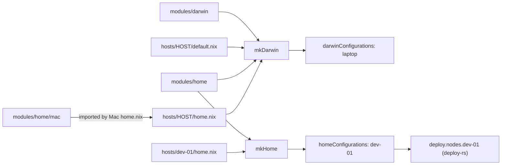
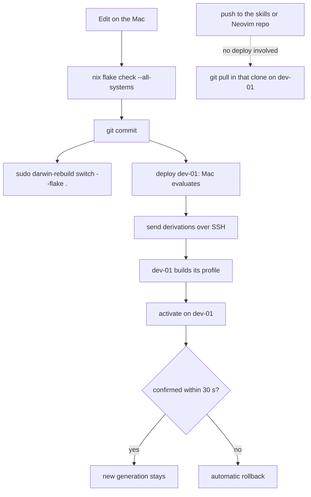
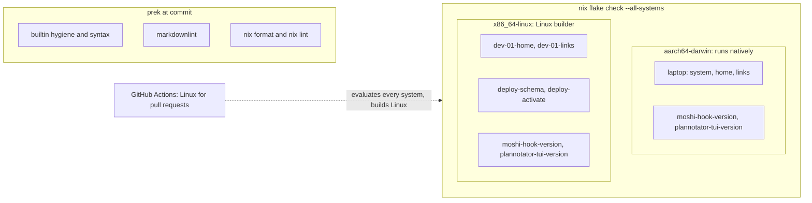

# Nix configuration

A personal flake. [nix-darwin](https://github.com/nix-darwin/nix-darwin) (the
Nix module system for macOS) owns each Mac's settings and applications, and
[Home Manager](https://nix-community.github.io/home-manager/) owns the user
environment: embedded in the Mac configuration, and standalone on the Linux VM.
The reasons behind the choices are in [DESIGN.md](DESIGN.md).

| Host | What it is | Flake output | Switched with |
| --- | --- | --- | --- |
| `laptop` | MacBook Pro (M5), user `michael` | `darwinConfigurations.laptop` | `sudo darwin-rebuild switch --flake .` on the laptop |
| `dev-01` | Ubuntu VM, reached over SSH from the Mac | `homeConfigurations."dev@dev-01"` | `deploy .#dev-01` from the Mac |

dev-01 is Home Manager only: the
machines repo's bootstrap owns everything outside its home directory.

## Structure

```text
flake.nix                inputs, mkDarwin, mkHome, deploy node, checks
hosts/<host>/
├── default.nix          nix-darwin: host name, platform, user name, stateVersion (Macs)
└── home.nix             Home Manager: host-only modules, identity, stateVersion
modules/darwin/          nix-darwin modules shared by the Macs
modules/home/            Home Manager modules shared by every host
└── mac/                 Home Manager modules only the Macs import
pkgs/<name>/             packages nixpkgs lacks (moshi-hook, plannotator-tui), added by overlays/additions.nix
overlays/                applied to every package set, so modules use pkgs.<name>
├── additions.nix        packages from pkgs/
├── modifications.nix    local fixes to nixpkgs packages (JankyBorders patches, Mole bump)
├── security.nix         security fixes ahead of nixpkgs; empty between incidents
└── patches/<package>/   patch files the overlays apply
config/                  raw application files, linked or read by the modules
prek.toml                commit hooks
.github/workflows/       CI: pull requests on Linux, the cache filled from macOS
```

Concern files define existing nix-darwin or Home Manager options. Add a setting
to the shared module for its concern, or to `hosts/<host>/` when only one
machine needs it.

| Module | What it does |
| --- | --- |
| `darwin/system.nix` | DNS, firewall, Touch ID for sudo, tailnet-only sshd, Dock, Finder, keyboard, power settings |
| `darwin/applications.nix` | system packages, fonts, Homebrew casks, formulae and App Store apps |
| `darwin/nix.nix` | Determinate Nix owning the Nix installation and garbage collection, a weekly launchd job that expires system generations older than 7 days, no bundled `darwin-uninstaller` |
| `darwin/user.nix` | the primary user's account and shell (the name itself is set in `hosts/<host>/default.nix`), Home Manager's integration settings |
| `darwin/window-management.nix` | yabai |
| `home/live-files.nix` | `nixConfig.checkout`, `nixConfig.skills` and `lib.nixConfig.file`, see [Live configuration](#live-configuration) |
| `home/shell.nix`, `cli.nix`, `yazi.nix` | fish, command-line tools, yazi |
| `home/git.nix` | Git settings, `hunk` diff viewer, `gh`, `lazygit` |
| `home/neovim.nix` | Neovim and the runtime tools Mason needs |
| `home/herdr.nix` | Herdr (terminal multiplexer) and its live config, the Annotate plugin linked from Nix and its review pane's Tokyo Night config |
| `home/agents.nix` | skills links, `AGENTS.md`, Claude Code, Codex and Pi from llm-agents.nix with their settings, Pi's Tokyo Night theme |
| `home/moshi.nix` | the Moshi user service, see [Services](#services) |
| `home/mac/ssh.nix`, `git.nix` | SSH hosts and keys, Git identities and macOS ignores |
| `home/mac/terminals.nix`, `karabiner.nix` | Ghostty and Karabiner, as live links |
| `home/mac/window-management.nix` | JankyBorders, and skhd with its live `skhdrc` |
| `home/mac/packages.nix` | Mac-only tools (`doctl`, Mole as `mo`, `spotify_player`, document rendering for Neovim) |

`mkDarwin` and `mkHome` in `flake.nix` assemble each host from these directories.
A host's `home.nix` adds host-only modules on top of the shared home; each Mac's
imports `modules/home/mac`, dev-01's does not.



## Set up a new Mac

Needed once on a new machine, in this order:

1. Install Nix with the [Determinate installer](https://docs.determinate.systems/).
   Determinate Nix is a Nix distribution that manages its own daemon,
   configuration and garbage collection; this flake's `determinateNix.enable`
   makes nix-darwin leave Nix to it.

   Then give its daemon Full Disk Access, which Nix cannot declare: in System
   Settings, Privacy & Security, Full Disk Access, add
   `/usr/local/bin/determinate-nixd`, and restart it with
   `sudo launchctl kickstart -k system/systems.determinate.nix-daemon`. Without
   it, macOS stops the daemon deleting any app bundle in the store that has
   been run, and `nix store gc` aborts with `fchmodat … Operation not
   permitted`.
2. Install [Homebrew](https://brew.sh/). nix-darwin installs the casks and
   formulae listed in `modules/darwin/applications.nix`, but not Homebrew
   itself.
3. Clone this repository over HTTPS; SSH works only after the first switch:
   `git clone https://github.com/mich-murphy/nix-config.git ~/dev/nix-config`.
   The Macs link live files into `~/dev/nix-config`; keep it there.
4. Clone the two repositories Home Manager links to, also over HTTPS:

   ```sh
   git clone https://github.com/mich-murphy/skills.git ~/dev/skills
   git clone https://github.com/mich-murphy/neovim.git ~/.config/nvim
   ```

5. Set up the 1Password SSH agent. The private keys exist only in 1Password.
   This flake writes each key's public half to `~/.ssh/`, and the SSH config
   uses that file to pick the one key a host needs from the agent. Sign in to
   the 1Password app, then turn on Settings, Developer, "Use the SSH agent".
   The agent needs these items:

   | 1Password item | Public key file | Used for |
   | --- | --- | --- |
   | `GitHub - mich-murphy` | `github.pub` | github.com (personal account) |
   | `GitHub - BusinessCraft` | `github_bc.pub` | Git inside `~/businesscraft/` (work account) |
   | `dev-01` | `dev-01.pub` | the `dev-01` host |
   | `docker-host` | `docker-host.pub` | `docker-host` on the tailnet |
   | `truenas` | `truenas.pub` | `truenas`, reached through `docker-host` |

   A host is offered only the key its entry in `modules/home/mac/ssh.nix`
   names, and a host with no entry is offered none. To add a key, put its
   public half in `publicKeys` there and name it in the host's entry.
6. Check, then do the first switch. `darwin-rebuild` does not exist yet, so run
   it through `nix run`, and name the host: the machine's hostname does not match
   a flake name until this first activation has set it.

   ```sh
   cd ~/dev/nix-config
   nix flake check --no-write-lock-file
   sudo nix run nix-darwin/master#darwin-rebuild -- switch --flake .#laptop
   ```

   From then on `sudo darwin-rebuild switch --flake .` is enough. Log out and
   back in once, so that macOS loads the keyboard shortcuts and key repeat the
   switch wrote. Then move the clones from step 3 and 4 to SSH:

   ```sh
   git -C ~/dev/nix-config remote set-url origin git@github.com:mich-murphy/nix-config.git
   git -C ~/dev/skills remote set-url origin git@github.com:mich-murphy/skills.git
   git -C ~/.config/nvim remote set-url origin git@github.com:mich-murphy/neovim.git
   ```

   If a switch stops with "Existing file ... would be clobbered", something
   has written a file where Home Manager puts a link. Move that file aside and
   switch again.
7. Open a new shell, then install the commit hooks: `prek install`.
8. Install the Herdr plugin Nix does not install. `config/herdr/config.toml`
   binds keys to it and to Annotate, which a switch builds and registers
   with `herdr plugin link` (`modules/home/herdr.nix`). Do not
   `herdr plugin install` Annotate: Herdr refuses to install over the link.

   ```sh
   herdr plugin install -y lmilojevicc/herdr-splits.nvim --ref v0.5.4
   herdr plugin list   # annotate shows local:/nix/store/…
   ```

## Set up dev-01

dev-01 has no checkout of this repo. You deploy to it from a set-up Mac (above).
The deploy path is proven; items marked "assumed" could not be checked from the
Mac.

On dev-01:

1. Install Nix (assumed: Determinate, the same as on the Mac) and enable flakes.
2. Have the `dev` user with `/home/dev` and SSH access from the Mac with the
   `dev-01` 1Password key (the Mac's `dev-01` SSH alias names that user and
   key).
3. Clone the same skills and Neovim repositories to `~/dev/skills` and
   `~/.config/nvim` (they need GitHub access from the VM).
4. Create `~/.gitconfig-work`, the work identity that `hosts/dev-01/home.nix`
   includes (the machines repo's bootstrap is meant to write it), and the
   `~/businesscraft/.scratch` directory that `TMPDIR` points at.

dev-01 is not logged in to FlakeHub Cache, so no cache credential sits on a
machine agents run on, and it needs nothing from that cache. It does need
Numtide's cache for the agent CLIs, in its system Nix configuration, which
the machines repo owns; `dev` is not a trusted Nix user, so the profile
cannot add it. Without it, a deploy compiles codex on dev-01.

Then, from the Mac checkout:

1. `deploy .#dev-01`.
2. On dev-01, run the `herdr plugin install` command from step 8 above.

## Day to day



1. Edit on the Mac.
2. Verify: `nix flake check --all-systems` (see [Verification](#verification)).
3. Commit. Both switch commands build the working tree as it is, so an
   uncommitted tree still builds, but the recorded revision then ends in
   `-dirty`.
4. Switch the Mac with `sudo darwin-rebuild switch --flake .`. The Nix
   daemon reads its substituters and keys only at start, so after a switch
   that changes them (`modules/darwin/nix.nix`), restart it with
   `sudo launchctl kickstart -k system/systems.determinate.nix-daemon`;
   until then it builds what the new cache would serve.
5. Deploy dev-01 with `deploy .#dev-01` (the `deploy` command is in the flake's
   dev shell: `nix develop`). deploy-rs first runs `nix flake check` for the
   Mac's own system (skip it with `--skip-checks` once you have run the full
   gate). `deploy --dry-activate .#dev-01` shows what would change. dev-01
   builds its own profile because `dev` is not a trusted Nix user there, so the
   Mac sends derivations, not a built closure.
6. See what each host runs:

   | Host | Command |
   | --- | --- |
   | Mac | `darwin-version --configuration-revision` |
   | dev-01 | `ssh dev-01 cat .local/state/nix-config/revision` |

7. Roll back. On a Mac: `sudo darwin-rebuild switch --rollback`. On dev-01: a
   failed activation, or no confirmation within 30 seconds, rolls back by
   itself (deploy-rs "magic rollback"). To undo a deploy that went through,
   deploy the previous commit by reference (this form evaluates, but has not
   been run through a real deploy):

   ```sh
   deploy "git+file://$PWD?rev=$(git rev-parse HEAD~1)#dev-01"
   ```

## Verification

Two commands are the gate: `prek run --all-files` lints, and
`nix flake check --all-systems` builds. The commit hooks run prek at each
commit.



- `<host>-system` and `<host>-home` build each Mac; `<host>-links` and
  `dev-01-links` confirm every live link points at a file that exists in this
  repo (or into the skills clone; dev-01 has no checkout).
- `deploy-schema` and `deploy-activate` are deploy-rs's checks of the dev-01
  node.
- `moshi-hook-version` runs `moshi-hook --version` on Linux and, on the Macs,
  reads the version from the app bundle's `Info.plist` without running it.
- `plannotator-tui-version` builds plannotator-tui from source, with its
  tests, and runs `plannotator-tui --version`.

The `x86_64-linux` checks build through Determinate Nix's native Linux builder
on the Mac. It sometimes fails to start with "HTTP 400" or "unexpected EOF";
run the check again.

`prek run --all-files` is the only lint: nixfmt, nixf-diagnose, markdownlint
and file hygiene hooks; `prek install` (set-up step 7) makes it run on each
commit.

The GitHub workflow runs on every pull request, on each push to `main` and on
demand. Pull requests run one Linux job, `check`: the commit hooks,
`nix flake check --all-systems --no-build` to evaluate every host, the Macs
included, and `nix flake check` to build the Linux checks. The Mac checks are
built only by the local gate. Branch protection requires `check` to pass
before a pull request merges.

On a push to `main` the `cache` job runs on macOS instead. It builds the Mac
checks and pushes every path cache.nixos.org lacks to FlakeHub Cache, so the
Macs download those paths rather than build them. A switch does not wait for
it; anything not yet cached builds locally. DESIGN.md (Binary cache) says how
pushes are restricted.

## Live configuration

Some files are
[out-of-store links](https://nix-community.github.io/home-manager/usage/dotfiles.html):
symlinks into a working copy, so an edit applies without a switch. Where a host
has no checkout (`nixConfig.checkout = null` on dev-01), the same file comes from
the deployed generation and is read-only.

| File or tool | Mac | dev-01 | Edit it |
| --- | --- | --- | --- |
| Ghostty, Karabiner, skhd | live link into the checkout | not installed | on the Mac, in `config/` |
| Herdr, `AGENTS.md` | live link into the checkout | read-only, from the deployed generation | on the Mac, then deploy |
| Skills | live link into `~/dev/skills` | live link into `~/dev/skills` | in that clone; `git pull` on dev-01 |
| Neovim config | clone at `~/.config/nvim` | clone at `~/.config/nvim` | in that clone; `git pull` on dev-01 |
| Claude Code and Pi settings | regular files; a switch merges the keys declared in `modules/home/agents.nix` | same, on deploy | declared keys in Nix; the rest in the app |
| Codex `config.toml` | regular file; a switch merges the key declared in `modules/home/agents.nix` | same, on deploy | in the app |

Notes:

- A declared setting changed in the app is reset on the next switch; change it
  in Nix. If a switch stops with "changed during activation", an agent saved its
  settings at that moment; run it again.
- `lib.nixConfig.file "<path>"` in a module picks the live link or the store
  copy. If a Mac's checkout moves, set `nixConfig.checkout`.
- Herdr does not watch its config. After editing it, press `Ctrl+A`, then
  `Shift+R` in each running session.
- Karabiner owns its whole config directory; its generated backups and complex
  modifications are git-ignored.
- `config/wezterm/` is kept for possible future use; WezTerm is not installed
  or linked.
- The Dock's icons are declared in `darwin/system.nix`. One dragged in by hand
  lasts until the next switch.
- LinearMouse's settings are not in this repository; set them in the app on
  each Mac.
- yabai writes to `/tmp/yabai_<user>.err.log` and skhd to
  `~/Library/Logs/skhd/skhd.err.log`. Look there when a rule or a key binding
  does nothing.
- JankyBorders draws a 3 pt cyan border around the focused window. Its
  settings are in `home/mac/window-management.nix`; to try a value without a
  switch, run `borders <option>=<value>`, which updates the running instance
  until it restarts. It logs to `~/Library/Logs/borders/`. It is patched so
  that the border follows the rounder bottom corners macOS gives a window near
  the display's rounded corners, hides while Mission Control is open, and
  stays below a window's sheets and open panels; see
  [Patched packages](#patched-packages).
- Desktops: docked, the external display has 1 to 5 and the laptop 6 (Teams)
  and 7 (Slack); undocked, the laptop has 1 to 5 and Teams and Slack move to
  3. Set the counts in Mission Control; yabai cannot add desktops with SIP on.
  Alt+number switches desktop, Shift+Alt+number moves the focused window
  there and follows it, and Shift+Alt+H/J/K/L or N/P move it to another
  display. If a window will not move, yabai missed it when it opened;
  `launchctl kickstart -k gui/$(id -u)/org.nixos.yabai` restarts yabai.
- On macOS 27, Ctrl+3 and above stop switching desktops after a display
  connects or disconnects, until the Dock restarts. yabai restarts it two
  seconds after each change, so expect the Dock to flicker then. Shift+Alt+D
  restarts it by hand; windows stay where they are.

## Where packages go

| Put it in | When |
| --- | --- |
| `environment.systemPackages` | a tool for every user of the Mac, root included, or an app bundle that must sit in `/Applications/Nix Apps` |
| `home.packages` | a general command-line tool used in any directory |
| `programs.neovim.extraPackages` | only Neovim or Mason shells out to it (`go`, `python3` and, on the Macs, `nodejs` live here for Mason) |
| Homebrew | a closed-source Mac app, or one that needs a system extension, a privileged helper, a fixed `/Applications` path or macOS permissions that reset when its signature changes; or something nixpkgs lacks |
| a project's dev shell | it is that project's toolchain |

### Changing the application list

Homebrew cleanup runs on every switch and uninstalls, without `zap`, what
`modules/darwin/applications.nix` no longer declares. That includes App Store
apps installed by hand, despite what the `masApps` option text says
([nix-darwin issue 1860](https://github.com/nix-darwin/nix-darwin/issues/1860)).
Before switching, list what the working tree would remove:

```sh
nix eval --raw .#darwinConfigurations.laptop.config.homebrew.brewfile |
  HOMEBREW_NO_AUTO_UPDATE=1 brew bundle cleanup --file=-
```

Without `--force` it only lists; no output means nothing would be removed.
Removing one Office cask also removes the licensing helpers the others share,
so check the remaining Office apps afterwards.

### Patched packages

The `jankyborders` entry in `overlays/modifications.nix` overrides nixpkgs'
JankyBorders with three patches in `overlays/patches/jankyborders/`, so its
version follows nixpkgs. Each patch is one `git format-patch` commit, and they
apply in this order on top of upstream's `v1.9.0` tag:

| Patch | Fixes |
| --- | --- |
| `screen-corner-radii.patch` | the border keeps the normal radius where macOS rounds a window's bottom corners near the display's rounded corners |
| `mission-control.patch` | on macOS 27 the borders stay on screen, unscaled, over Mission Control ([issue 209](https://github.com/FelixKratz/JankyBorders/issues/209)); based on [andrewcincotta/JankyBorders@0017b53](https://github.com/andrewcincotta/JankyBorders/commit/0017b53) |
| `attached-sheets.patch` | the border is drawn over a window's sheets and open panels |

cache.nixos.org has no build of the patched package, so it builds locally,
which takes a few seconds.

When a nixpkgs update bumps JankyBorders, evaluation stops at the version
assertion in `overlays/modifications.nix`. Check which of the fixes the new
release has, and delete those patches from the overlay and from
`overlays/patches/jankyborders`. Apply the rest to the new tag, resolve the
conflicts, export them again and update the asserted version (`v1.10.0`
stands for the new version):

```sh
patches=~/dev/nix-config/overlays/patches/jankyborders
git clone https://github.com/FelixKratz/JankyBorders && cd JankyBorders
git switch -c local-fixes v1.10.0
for p in screen-corner-radii mission-control attached-sheets; do
  git am -3 "$patches/$p.patch"   # on conflict: fix, git add, git am --continue
done
make && ./bin/borders --version
git format-patch -1 HEAD~2 --stdout --no-signature > "$patches/screen-corner-radii.patch"
git format-patch -1 HEAD~1 --stdout --no-signature > "$patches/mission-control.patch"
git format-patch -1 HEAD --stdout --no-signature > "$patches/attached-sheets.patch"
nix build ~/dev/nix-config#jankyborders
```

Once upstream has all three fixes, delete the `jankyborders` entry in
`overlays/modifications.nix` and `overlays/patches/jankyborders`.

`pkgs/plannotator-tui/package.nix` builds plannotator-tui, the review pane of
Herdr's Annotate plugin, with patches in `overlays/patches/plannotator-tui/`.
None is submitted upstream. Each patch is one `git format-patch` commit, and
they apply in this order on top of upstream's `v0.10.0` tag:

| Patch | Adds |
| --- | --- |
| `colour-roles.patch` | `[colors]` roles for inline code, code blocks, links and quotes, which upstream hardcodes |
| `code-highlighting.patch` | syntax highlighting of fenced code with the TextMate theme `[ui] code_theme` names; unset, nothing is highlighted |
| `mermaid-diagrams.patch` | fenced `mermaid` blocks drawn as text by [boxmaid](https://crates.io/crates/boxmaid), pinned to `=0.1.1`; `[ui] mermaid = false` turns it off, and a diagram boxmaid cannot draw shows its source |

They are `cargoPatches`, not `patches`: the last two change `Cargo.lock`, and
the vendored dependencies are fetched after the patches apply. A change to a
patch's `Cargo.lock` hunk therefore changes `cargoHash` too.

To move to a new release (`v0.11.0` stands for it), apply the patches to the
new tag, resolve the conflicts, export them again, then update `version`,
`hash` and `cargoHash` together (build once with `lib.fakeHash` for each hash
and copy the one Nix reports):

```sh
patches=~/dev/nix-config/overlays/patches/plannotator-tui
git clone https://github.com/plannotator/plannotator-tui && cd plannotator-tui
git switch -c local-fixes v0.11.0
for p in colour-roles code-highlighting mermaid-diagrams; do
  git am -3 "$patches/$p.patch"   # on conflict: fix, git add, git am --continue
done
cargo fmt --all --check && cargo clippy --workspace --all-targets -- -D warnings && cargo test --workspace
git format-patch -1 HEAD~2 --stdout --no-signature > "$patches/colour-roles.patch"
git format-patch -1 HEAD~1 --stdout --no-signature > "$patches/code-highlighting.patch"
git format-patch -1 HEAD --stdout --no-signature > "$patches/mermaid-diagrams.patch"
nix build ~/dev/nix-config#plannotator-tui
```

Run the `cargo` commands inside
`nix shell nixpkgs#cargo nixpkgs#rustc nixpkgs#clippy nixpkgs#rustfmt`.

## Services

Moshi runs as a user service on every host (launchd on the Macs, systemd on
dev-01). The laptop also runs llama-server.

**Moshi** (`pkgs/moshi-hook`) is pinned to one release. To update it, change
`version` and both checksums from Moshi's
[Homebrew formula](https://github.com/rjyo/homebrew-moshi/blob/main/Formula/moshi-hook.rb).
Hooks written into each agent name a stable path (`/Applications/Nix
Apps/MoshiHook.app` on the Macs, `~/.local/libexec/moshi-hook` on Linux), so do
not change it. A switch reinstalls the hooks only when `moshi-hook status`
reports them out of date. The Macs run the service from the installed app
bundle, never from the store, because macOS makes a store bundle that has run
undeletable for garbage collection.

**llama-server** (`hosts/laptop/llama.nix`) serves local models to Pi through
llama.cpp's router on `127.0.0.1:9931`, which `LLAMA_BASE_URL` points Pi at.
llama.cpp comes from nixpkgs, and the router runs at login. Presets are in
`config/llama/models.ini`, with model paths relative to `~/models`. A loaded
model sleeps after 5 idle minutes and frees its memory; the idle router holds
about 0.1 GB. Select a model with `/model` in Pi, or load one with `/llama`.
The log is `~/Library/Logs/llama-server.log`. A switch that upgrades llama.cpp
restarts the router, which unloads any loaded model; other switches leave it
running. To restart it by hand, run
`launchctl kickstart -k gui/$(id -u)/org.nix-community.home.llama-server`.

The model files are not managed by Nix. To fetch them on a new laptop:

```sh
hf=https://huggingface.co/unsloth
fetch() { curl -fL --create-dirs -C - -o ~/models/$1 "$hf/$2?download=true"; }
fetch qwen3.6-35b-a3b/Qwen3.6-35B-A3B-UD-Q5_K_XL.gguf Qwen3.6-35B-A3B-MTP-GGUF/resolve/main/Qwen3.6-35B-A3B-UD-Q5_K_XL.gguf
fetch qwen3.6-35b-a3b/mmproj-F16.gguf Qwen3.6-35B-A3B-MTP-GGUF/resolve/main/mmproj-F16.gguf
```

## Notes

- Determinate Nix manages Nix itself and its garbage collection on the Macs
  (`determinateNix.enable`); nix-darwin's own Nix management is off.
- The user flake registry pins `nixpkgs` to this flake's input, so
  `nix shell nixpkgs#…` uses the same revision as the system instead of
  Determinate's default `nixpkgs-weekly`.
- `nix develop` provides `nixfmt`, `nixf-diagnose`, `nvd` and `deploy`. For
  direnv, create a local `.envrc` containing `use flake` (globally ignored).
- `nvd diff /run/current-system ./result` after `darwin-rebuild build --flake .`
  shows what a switch would change.
